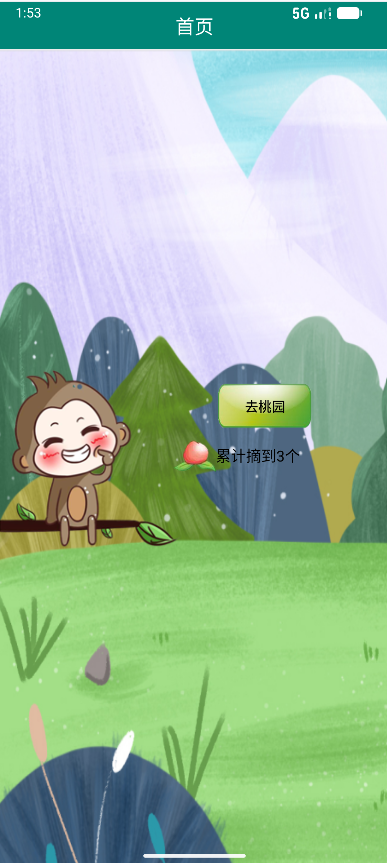
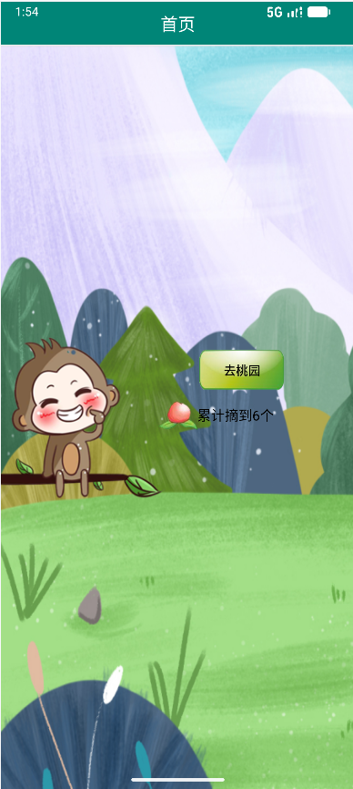
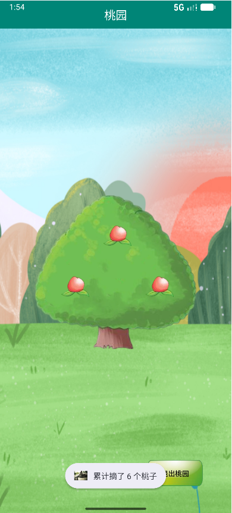

# 摘桃记 · PickPeach

一个基于 Android（Java）的「摘桃子」小游戏 Demo：从首页进入桃园，点击桃子把它摘下来并累计计数，退出桃园时把**累计摘桃数**带回首页显示。数据保存在 `SharedPreferences` 中，退出 App、重启手机都不会丢失。

> 课程练习 / 学习项目，重点演示：`RelativeLayout` 定位、`Activity` 跳转与结果回传、`SharedPreferences` 持久化、`Toast` 提示。

---

## 功能

- 🏠 **首页**：显示「累计摘到 N 个」，点击「去桃园」进入桃园页面
- 🌳 **桃园页**：树上有 6 个桃子，点击后桃子消失、累计数 +1、弹出 Toast 提示
- 🔁 **数据回传**：点击「退出桃园」把累计数带回首页并刷新显示
- 💾 **持久化**：累计数存 `SharedPreferences`，杀进程重开仍保留
- 🖱️ **返回键兜底**：即使按系统返回键退出，首页 `onResume` 也会重新读取累计数

## 界面流程

```
首页 (Peach.MainActivity)
  │  显示「累计摘到 N 个」
  │
  │  点击「去桃园」 ── Intent ──▶
  ▼
桃园 (PeachActivity)
  │  点击桃子 → 桃子消失 + 累计数 +1 + Toast
  │
  └─ 点击「退出桃园」── setResult(RESULT_OK, 累计数) ──▶ 回到首页并刷新显示
```

## 界面截图

| 首页（摘到 3 个） | 继续摘（累计 6 个） | 桃园（点击提示） |
| :---: | :---: | :---: |
|  |  |  |

> 累计数保存在 `SharedPreferences` 中：退出桃园、杀掉 App 再打开，都会接着上一次的数量继续累加。

## 技术栈

| 项目 | 版本 |
| --- | --- |
| 语言 | Java 11 |
| compileSdk / targetSdk | 36 |
| minSdk | 24（Android 7.0） |
| Android Gradle Plugin | 9.3.2 |
| Gradle | 9.5.0 |
| JDK | **25**（`gradle/gradle-daemon-jvm.properties` 要求；用 Android Studio 自带的 `jbr` 即可） |
| 主要依赖 | appcompat、material、constraintlayout、activity-ktx、recyclerview |

## 目录结构

```
app/src/main/
├── AndroidManifest.xml                  # 只注册 1 个启动入口：Peach.MainActivity
├── java/com/example/myapplication/Peach/
│   ├── MainActivity.java                # 首页：显示累计数、跳转桃园、接收结果
│   └── PeachActivity.java               # 桃园：点桃子计数、退出回传
└── res/
    ├── layout/
    │   ├── activity_main_peach.xml      # 首页布局
    │   └── activity_peach.xml           # 桃园布局（树 + 6 个桃子 + 退出）
    ├── drawable/
    │   ├── bg.png / monkey.png          # 首页场景背景、猴子
    │   ├── peach_pic.png / btn_peach.png# 桃子图标、绿色按钮
    │   └── tree.png / tree_bg.png       # 桃园：树、草地场景
    ├── drawable-hdpi/cat.png            # 应用图标
    └── values/
        ├── strings.xml                  # 文案：app_name / peach_title / peach_exit / peach_desc
        └── themes.xml                   # Material3 主题
```

## 关键实现

### 1. 累计数持久化

```java
// PeachActivity
public static final String PREFS_NAME = "peach_prefs";
public static final String KEY_TOTAL  = "total_count";

prefs = getSharedPreferences(PREFS_NAME, MODE_PRIVATE);
total = prefs.getInt(KEY_TOTAL, 0);        // 接着上次的累计数继续

private void pickPeach(View peach) {
    peach.setVisibility(View.INVISIBLE);   // 保留占位，其他桃子不跳动
    total++;
    prefs.edit().putInt(KEY_TOTAL, total).apply();   // 立即存盘
    Toast.makeText(this, "累计摘了 " + total + " 个桃子", Toast.LENGTH_SHORT).show();
}
```

### 2. 结果回传

```java
// PeachActivity：退出时把累计数放进 Intent
Intent data = new Intent();
data.putExtra(EXTRA_COUNT, total);
setResult(RESULT_OK, data);
finish();

// MainActivity：用 ActivityResultLauncher 接收
private final ActivityResultLauncher<Intent> peachLauncher =
        registerForActivityResult(new ActivityResultContracts.StartActivityForResult(), result -> {
            if (result.getResultCode() == RESULT_OK && result.getData() != null) {
                showCount(result.getData().getIntExtra(PeachActivity.EXTRA_COUNT, 0));
            }
        });
```

### 3. 桃园布局：固定尺寸「画布」

桃子用 `RelativeLayout` + `layout_marginStart/Top` 以绝对坐标摆放在 300dp × 289dp 的容器里（比例与 `tree.png` 一致），树背景不会被拉伸变形：

```xml
<RelativeLayout
    android:layout_width="300dp"
    android:layout_height="289dp"
    android:background="@drawable/tree">

    <ImageView
        android:id="@+id/btn_one"
        android:layout_width="45dp"
        android:layout_height="35dp"
        android:layout_alignParentStart="true"
        android:layout_alignParentTop="true"
        android:layout_marginStart="128dp"
        android:layout_marginTop="55dp"
        android:scaleType="fitCenter"
        android:src="@drawable/peach_pic" />
    ...
</RelativeLayout>
```

## 构建与运行

```bash
# 克隆
git clone https://github.com/Hamburger02Pro/PickPeach.git
cd PickPeach
```

1. 用 **Android Studio** 打开项目根目录（含 `settings.gradle.kts` 的那一层）
2. 确保已安装 **SDK Platform 36**（`Tools → SDK Manager`）
3. 等待 Gradle Sync 完成
4. 选择运行配置 **app** → 点绿色三角运行

### 环境要求：JDK 25

`gradle/gradle-daemon-jvm.properties` 里写着 `toolchainVersion=25`，因此**命令行构建需要 JDK 25**。
不用另外下载，Android Studio 自带的 `jbr` 就是 25，把它设为 `JAVA_HOME` 即可。

**Windows（PowerShell）**

```powershell
# 路径按你的 Android Studio 安装位置调整
$env:JAVA_HOME = 'D:\Program\Android\Android Studio\jbr'
$env:Path = "$env:JAVA_HOME\bin;$env:Path"

java -version        # 应输出 25.x
```

永久生效（设置一次，以后所有终端都能用）：

```powershell
[Environment]::SetEnvironmentVariable('JAVA_HOME','D:\Program\Android\Android Studio\jbr','User')
[Environment]::SetEnvironmentVariable('Path',
  [Environment]::GetEnvironmentVariable('Path','User') + ';D:\Program\Android\Android Studio\jbr\bin','User')
```

**macOS**

```bash
export JAVA_HOME="/Applications/Android Studio.app/Contents/jbr/Contents/Home"
```

**Linux**

```bash
export JAVA_HOME="$HOME/android-studio/jbr"   # 按实际安装路径调整
```

命令行构建：

```bash
./gradlew :app:assembleDebug
```

## 常见问题

**Q：模拟器窗口黑屏，但 App 明明在运行？**
先确认设备真实画面：

```bash
adb exec-out screencap -p > screen.png
```

如果截图正常、只有 Studio 窗口黑，说明是模拟器窗口渲染问题，不是代码问题。解决办法：

- `Device Manager` → `⋮` → **Cold Boot Now**
- 或在 AVD 编辑里把 **Graphics** 改成 `Software - GLES 2.0`
- 或改用 [scrcpy](https://github.com/Genymobile/scrcpy) 投屏查看

**Q：桌面出现两个一样的图标？**
`AndroidManifest.xml` 里每个带 `MAIN` + `LAUNCHER` 的 Activity 都会生成一个图标。本项目只保留 `Peach.MainActivity` 一个入口。

**Q：编译报 `requires compiling against version 37`？**
某个依赖要求更高的 `compileSdk`，把 `app/build.gradle.kts` 里的 `compileSdk` 调高，或降低对应库的版本。

**Q：命令行编译报 `Unable to download toolchain matching the requirements`？**
Gradle 要 JDK 25，但当前终端没有配置 `JAVA_HOME`，于是去 adoptium 自动下载（`github.com` 国内常连不上）。
不用真的去下载，按上面「环境要求：JDK 25」把 `JAVA_HOME` 指向 Android Studio 自带的 `jbr` 即可：

```powershell
$env:JAVA_HOME = 'D:\Program\Android\Android Studio\jbr'
```

## 踩坑记录

开发过程中遇到的真实问题，按「现象 → 原因 → 解决」记录，供后来者参考。

| # | 现象 | 原因 | 解决 |
| :--: | --- | --- | --- |
| 1 | `AAPT2` 报 `Attribute value expected` + `Unexpected text found in layout file` | 属性值少了开头的引号：`android:layout_marginLeft=85dp"` | 补成 `android:layout_marginStart="85dp"` |
| 2 | 布局预览里桃子一个都不显示 | ① 上面的语法错误导致整个 `<Button>` 标签解析失败；② `<Button>` 在 Material3 主题下被实例化为 `MaterialButton`，其 `backgroundTint` 会把图片按 SRC_IN 染色 | 改用 `ImageView + android:src`，不再给图片设 `background` |
| 3 | 树被拉伸、桃子位置对不上 | 装树的 `RelativeLayout` 是 `wrap_content`，背景图被子的包围盒撑得变形；`layout_below` + `layout_toRightOf` 与 `marginLeft` 叠加后语义混乱 | 容器固定为 300dp × 289dp（与 `tree.png` 同比例），桃子用 `alignParentStart/Top` + `marginStart/Top` 绝对定位 |
| 4 | Gradle 同步一直转圈，`themes.xml` 整片标红 | `compileSdk 37` 未安装，AGP 在后台尝试下载 SDK | 安装 SDK Platform 37，或把 `compileSdk/targetSdk` 降到已安装的 36 |
| 5 | 模拟器黑屏，但 App 其实在运行 | Android Studio 的模拟器**窗口**渲染损坏，设备帧缓冲本身正常 | 用 `adb exec-out screencap -p > x.png` 截真实画面判断；AVD 配置 `hw.gpu.mode=swiftshader_indirect` 或改用 `scrcpy` |
| 6 | 桌面上出现两个同名图标 | `PeachActivity` 也声明了 `MAIN` + `LAUNCHER` | 删掉它的 `<intent-filter>`，只保留 `Peach.MainActivity` 一个入口 |
| 7 | `git push` 报 `error setting certificate file` | Git 安装在 `D:\Program\Git`，但系统 `gitconfig` 里的 `sslCAInfo` 仍指向旧的 `D:/Program Files/Git/...` | 改成 `D:/Program/Git/mingw64/etc/ssl/certs/ca-bundle.crt` |
| 8 | Studio 的 Share Project 报 `Connection refused: getsockopt` | IDE 的 HTTP Proxy 指向了没有监听的端口（7890） | 设为 `No proxy`（直连可用）或改成实际在跑的 7892 |
| 9 | 命令行构建报 `Unable to download toolchain ... adoptium ... jdk-25` | `gradle-daemon-jvm.properties` 要求 JDK 25，终端未配置 `JAVA_HOME`，Gradle 转去 GitHub 下载 Temurin 25 被网络拦截 | 把 `JAVA_HOME` 指向 Android Studio 自带的 `jbr`（25），无需下载 |

### 排查思路

遇到「黑屏 / 不显示」这类问题，先分清是**应用问题**还是**显示 / 环境问题**，再动手：

1. `adb shell dumpsys window | findstr mCurrentFocus` —— 前台是不是我们的 Activity？
2. `adb exec-out screencap -p > check.png` —— 设备真实画面是什么样？
3. `adb logcat -d *:E | findstr AndroidRuntime` —— 有没有 `FATAL EXCEPTION`？

三条命令基本就能定位问题在哪一层，避免在代码里反复改却毫无效果。

## 更新日志

- **v1.1** — 应用更名为「摘桃记」；补充踩坑记录
- **v1.0** — 完成首页 / 桃园页、点击摘桃计数、结果回传、累计数持久化

